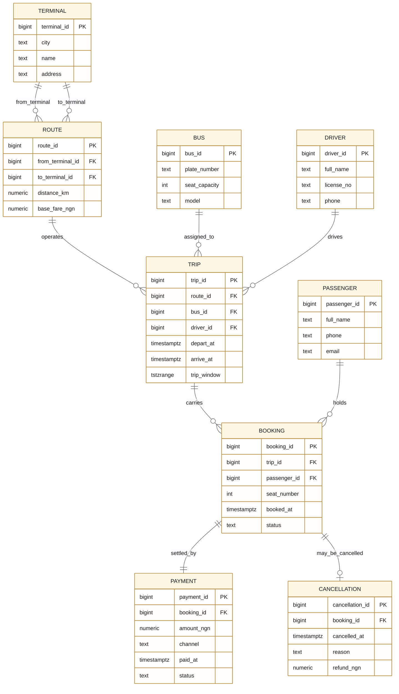

# Portfolio 1 — Database Design & Modelling

**Student:** Animashaun Adeola · **Matric:** 2026/A/MIT/0432 · **Case study:** RoadLink Express (inter-state bus booking)

> **Course-note session covered:** Study Session 1 — *Review of Traditional Relational Databases and Advanced Concepts* (DB design, normalisation, characteristics of a good database, ACID).

---

## What this portfolio demonstrates

A complete 3NF relational schema for an inter-state bus operator with **9 tables** and the full set of integrity constraints the CA demands:

| # | Requirement | Where it lives |
|---|---|---|
| 1 | ER diagram (Mermaid) | `er_diagram.mmd` |
| 2 | Relational schema, keys, FKs | `01_schema.sql` |
| 3 | **One passenger per seat per trip** — partial unique index on `(trip_id, seat_number)` for CONFIRMED bookings (a cancelled seat can be resold) | `01_schema.sql`, table `booking` |
| 4 | **No bus on two overlapping trips** — `EXCLUDE USING gist (bus_id WITH =, trip_window WITH &&)` on a `tstzrange` | `01_schema.sql`, table `trip` |
| 5 | **No driver on two overlapping trips** — same pattern | `01_schema.sql`, table `trip` |
| 6 | **Seat number ≤ bus capacity** and **booked before departure** — `BEFORE INSERT/UPDATE` trigger | `02_triggers.sql`, function `roadlink_check_booking()` |
| 6b | **Cancellation rules** — before departure, refund ≤ amount paid, booking → CANCELLED, payment → REFUNDED | `02_triggers.sql`, function `roadlink_on_cancellation()` |
| 7 | **Arrival after departure** — `CHECK (arrive_at > depart_at)` | `01_schema.sql`, table `trip` |
| 8 | **A route's two terminals must differ** — `CHECK (from_terminal_id <> to_terminal_id)` | `01_schema.sql`, table `route` |
| 9 | **Fare and payment > 0** — `CHECK (base_fare_ngn > 0)`, `CHECK (amount_ngn > 0)` | `01_schema.sql`, tables `route`, `payment` |
| 10 | 3NF walk-through | `notes_3nf.md` |
| 11 | Realistic seed data (terminals, routes, buses, drivers, passengers) | `03_seed.sql` |
| 12 | **Bulk generator: ≈ 180,000 bookings over 2 years + the next 14 days**, no seat sold twice, no bus/driver overlap, more trips in December + Sallah + Easter, realistic Nigerian names + ₦ fares | `04_bulk_generate.py` |
| 13 | Constraint tests that **must fail** | `05_constraint_tests.sql` |

---

## ER diagram

(GitHub draws this automatically. Source file: `er_diagram.mmd`.)



---

## Files

| File | Purpose |
|---|---|
| `er_diagram.mmd` | Mermaid ER diagram — paste into https://mermaid.live or any Mermaid-aware viewer |
| `01_schema.sql` | DDL: tables, keys, FKs, two `EXCLUDE … USING gist` constraints, partial unique indexes, view `v_seat_capacity`; makes the app role `roadlink` the owner |
| `02_triggers.sql` | Triggers for the rules a CHECK cannot express (they need another table): seat within capacity, booked before departure, cancellation rules |
| `03_seed.sql` | Seed data (8 terminals, 20 routes, 15 buses, 20 drivers, 60 passengers). Trips are made by the generator. |
| `04_bulk_generate.py` | ≈ 4,900 trips and ≈ 180,000 bookings over the past 730 days plus the next 14 days (upcoming trips partly booked), festive peaks and fares (December ×1.20, Sallah ×1.15, Easter ×1.10), each booking 0–14 days before departure, no double-sold seats, no bus/driver overlap, ~6% cancellations with 85% refunds. Dates are relative to today, so it never expires. |
| `05_constraint_tests.sql` | 16 bad inserts that must each be REJECTED, plus one positive check (a cancelled seat can be resold). Builds its own test data and runs inside BEGIN … ROLLBACK, so the generated data is untouched; stops `run_p1.sh` if any test fails |
| `notes_3nf.md` | Normalisation walk-through (1NF → 2NF → 3NF) for every table |
| `run_p1.sh` | End-to-end runner |

---

## How to run (Codespaces)

From the repo root, **once**:

```bash
bash setup.sh                # installs PostgreSQL 16 + MongoDB 8
```

Then, in this folder:

```bash
bash run_p1.sh
```

`run_p1.sh` does, in order:

1. `01_schema.sql` — drops & re-creates all tables and constraints
2. `02_triggers.sql` — creates the triggers
3. `03_seed.sql` — inserts the seed rows
4. `04_bulk_generate.py` — trips + ≈ 180k bookings (history + next 14 days)
5. `05_constraint_tests.sql` — runs the 16 "must fail" tests
6. Prints final counts

All `psql` calls go through:

```bash
sudo runuser -u postgres -- psql -d roadlink -f <file>.sql
```

which uses the Unix socket at `/var/run/postgresql` — **no password needed** (the trust line at the top of `pg_hba.conf` was added by `setup.sh`).

---

## What to screenshot for the LMS submission

1. `bash run_p1.sh` full output — the final counts table.
2. The ER diagram (it is drawn on this README page on GitHub — screenshot it there).
3. The 16-line `PASS` table from `05_constraint_tests.sql`.
4. `\d trip` and `\d booking` from `psql` to show the constraints in the live schema.
5. `SELECT to_char(t.depart_at,'YYYY-MM'), COUNT(b.booking_id) FROM trip t LEFT JOIN booking b USING(trip_id) GROUP BY 1 ORDER BY 1 DESC LIMIT 12;` — to show the December + festive peaks.
6. `SELECT COUNT(*) FROM booking;` showing ≥ 50,000 rows.

---

## Git commit

```bash
git add portfolio-1-database-design/
git commit -m "P1: ER diagram, 3NF schema, 9 tables, btree_gist EXCLUDEs, triggers, 180k bookings, 16 constraint tests"
git push
```

---

## Plain-English explanation

This portfolio builds the *shape* of the RoadLink Express database and proves
that it cannot hold inconsistent data. The nine tables mirror the real-world
objects a bus operator cares about: where buses depart from
(`terminal`), which terminal pairs we serve (`route`), the physical coaches
(`bus`), the people who drive them (`driver`), each scheduled run (`trip`),
the travellers (`passenger`), each seat reservation (`booking`), the payment
that confirms it (`payment`) and the optional cancellation with refund
(`cancellation`).

The interesting integrity rules are:

* **One seat, one passenger.** A unique index on `(trip_id, seat_number)`
  that only counts CONFIRMED bookings means a second booking for the same
  seat on the same trip is rejected by the storage engine, while a seat whose
  booking was cancelled can be sold again.
* **No bus in two places at once.** The `EXCLUDE USING gist (bus_id WITH =,
  trip_window WITH &&)` constraint treats `trip_window` (a `tstzrange`) as a
  geometric object and refuses any new trip whose time range *intersects* an
  existing trip's range *for the same bus*. The `btree_gist` extension is what
  lets `gist` index equality on a scalar like `bus_id`. Without it, EXCLUDE
  could only use range-overlap, not also equality on a scalar.
* **No driver on two trips at once** — same pattern, different column.
* **No seat outside the bus.** A `BEFORE INSERT/UPDATE` trigger joins the
  booking's trip → its bus → its `seat_capacity`, and raises a
  `check_violation` if the requested seat number is out of range. This cannot
  be a plain `CHECK` because the capacity lives on a different table
  (`bus.seat_capacity`) than the seat number (`booking.seat_number`).
* **Fare and payment sanity.** `route.base_fare_ngn > 0`, `payment.amount_ngn > 0`,
  `route.from_terminal_id <> route.to_terminal_id`, and
  `trip.arrive_at > trip.depart_at` are all `CHECK` constraints that the
  database enforces regardless of which client wrote the row.

The bulk generator loads two years of realistic traffic through all of these
rules (the database would reject any row that broke one). The 16-test
constraint suite in
`05_constraint_tests.sql` is the inverse experiment: it tries sixteen
deliberately bad inserts and proves each is rejected.

The work maps to **Session 1** of the Miva course notes (Traditional RDB,
normalisation, characteristics of a good database, ACID) and is the
foundation that the next four portfolios build on: queries (P2), transactions
(P3), the NoSQL model (P4) and the partitioned/replicated deployment (P5).
